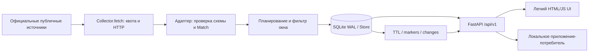

# Архитектура и контракты Fast Parser

Описание реализации 0.13.1, SQLite v3. Сверено 11.10.2026. Это описание существующего
кода, а не обещание реализации всего исходного ТЗ. Команды — [DEVELOPER_GUIDE.md](DEVELOPER_GUIDE.md).

## 1. Поток данных

HTTP API не ходит к источнику при чтении матчей. Поэтому задержка провайдера не
должна блокировать отображение сохраненной выборки. Кнопка sync ставит работу в
план, а не выполняет сеть в пользовательском запросе. UI отдельно опрашивает данные.
В ordinary serve web и worker находятся в одном процессе; lease защищает от двух
активных collectors, source tasks работают независимо друг от друга.

## 2. Startup и завершение

`lifecycle.serve` сначала bind 127.0.0.1, затем пишет token/PID в data/server-<port>.json.
Второй запуск на занятом порту не должен заменить control-token первого. Uvicorn
использует один worker. `app.create_app` создает Store, CSRF, маршруты и официальные
записи текущего сезона, если start_worker=true. РПЛ помечается недоступной, источник
однократно регистрируется blocked через rpl_discovery_status.

Lifespan запускает `Collector.run`. При stop/Ctrl+C задача отменяется, source jobs
завершаются отменой, httpx client закрывается, lease освобождается. Stop-request имеет
token конкретного запуска. Это безопасная остановка managed-server, а не поиск и
убийство процесса по имени. В Docker используется прямой uvicorn, поэтому остановка
через docker compose stop, а не Windows stop.cmd.

## 3. Worker и HTTP

- Lease `collector`, owner UUID, TTL 60 секунд, обновление в основном цикле около
  секунды. При потере lease jobs отменяются. Чужой lease не удалять руками.
- Максимум одна активная async-задача на source; разные источники не ожидают друг
  друга. Официальные квоты общие по source, не по соревнованию.
- Условие active_windows проверяется перед source_cycle. Очистка и heartbeat идут
  отдельно от окон сбора; worker не превращается в архив из-за паузы.
- HTTP client: timeout 20s, follow_redirects=false, общий deadline запроса 30s,
  максимум принятых bytes 5 MB, UTF-8. Соединения переиспользуются.
- `reserve_request` в транзакции BEGIN IMMEDIATE проверяет blocked/next_allowed
  и заранее сдвигает квоту. Рестарт не обнуляет допустимое время запроса.
- Минимальные паузы: official 30s, OpenLigaDB 12.5s, Sky Sports 20s.
- 401/403 и обнаруженная CAPTCHA → blocked до явной проверки/действия оператора.
  CAPTCHA в redirect Location распознается без перехода по challenge URL.
- 429 → Retry-After, минимум 60s; HTTP-дата тоже разбирается.
- Сетевой сбой → backoff; ошибка схемы → карантин 900s. Последние данные не стираются.
- `Deferred` означает квоту/blocked/ожидание, `SourceFailure` — отказ запроса/контракта;
  `ReferenceUnavailable` используется для отсутствующей контрольной страницы.
- Будущий parser использует fetch, не собственный безлимитный клиент. Производственные
  планы сохраняются до/после обработки по контракту; их нельзя считать временной памятью.

Текущий User-Agent содержит историческое `FastParser/0.8` — не показатель версии
продукта. Обновление идентификации/реестра можно сделать отдельным небольшим изменением.
Некоторые парсеры вызываются синхронно внутри source coroutine; общий объем ограничен,
но тяжелые новые обработчики следует переносить через to_thread и измерять event-loop.

## 4. Модель Match

| Группа полей | Контракт |
|---|---|
| id, competition_id | Стабильные имена в пространстве источника/лиги/сезона |
| source, external_id | Происхождение и внешний ключ; UNIQUE(source,external_id) |
| home_team, away_team | dict с непустым name и устойчивым id; без обоих id карточка не сохраняется |
| kickoff_at | ISO UTC с offset либо null; parse_time отвергает naive timestamp |
| scheduled_date | YYYY-MM-DD организатора при известном дне; не момент времени |
| status | scheduled/live/paused/finished/postponed/cancelled/abandoned/unknown |
| score_home/away | int либо null; 0 допустим, null не заменять нулем |
| regular/extra/penalties_home/away | Детализированный счет, если реально дан |
| period | first_half/half_time/second_half и поддержанные доп. фазы либо null |
| elapsed_minutes, added_minutes | Последняя опубликованная минута/добавленное время либо null |
| finished_at | Явный достоверный конец источника; не kickoff+90 минут |
| observed_at | Время последнего принятого upsert текущего матча |
| first_observed_finished_at | Стабильное первое наблюдение final/cancelled |
| expires_at, retention_anchor_method | TTL и источник якоря source/observed |
| source_updated_at | Ревизия провайдера для защиты от старых обновлений; обычно null |
| raw_status | Один статус источника либо null; не склейка флагов и не фрагмент времени |
| verification, result_verified | Происхождение карточки. true только при двух independent_confirmations |
| independent_confirmations | Список независимых подтверждений; по умолчанию пуст |
| source_url, public_match_url | Адрес сбора и отдельная публичная страница матча; оба nullable |
| kickoff_precision | instant, date_only или unknown |
| score_scope | regulation, including_extra, including_penalties или unknown |
| archive_until | Срок архива финала; null у незавершённой карточки |

`verification='official_source'` не означает независимую сверку результата.
`result_verified` по умолчанию false; не выставлять true только из-за официального домена.
Известный live без минуты показывается «минута недоступна», не 0-й минутой.

При date-only нельзя переводить день в UTC без известного часа. SQL-фильтр использует
приблизительный календарный день: start включителен, end в полночь исключает день,
end с часом включает пограничный день. Для точных timestamp остается >= start / < end.
Date-only карточки идут после карточек с kickoff, сортируются через COALESCE('9999').

## 5. Четыре независимых состояния

1. **Официальность**: source из центрального реестра, либо официальный префикс лиги.
2. **Работоспособность**: last_success, source_state и collection_state.
3. **Свежесть**: age от observed_at конкретного Match и допустимый интервал.
4. **Верификация покрытия**: CoverageVerification с scope/evidence и видами данных.

Историческое competitions.state='verified' выставляет mark_sync после успешной
выборки; API превращает его в collection_state='available'. Это не пункт 4.
source_state.closed/open/blocked характеризует circuit, а не полноту сезона.
У РПЛ может быть official_source=true и одновременно collection_supported=false.
`collection_allowed=false` также бывает у legacy из-за official_only: причины различать.

CoverageVerification: unverified без проверенных видов; partial требует хотя бы один
вид плюс scope/evidence; verified требует fixtures И results, но live остается отдельной
отметкой. Сохраняется по competition_id, новая лига/сезон не наследует чужую пометку.
Изменения пометок идут через каталог/audit, не через changes матчей.

## 6. SQLite и транзакции

Store открывает отдельное соединение для операции, foreign_keys=ON,
busy_timeout=10000ms, WAL. Контекст commit/rollback закрывает connection. В worker
блокирующие операции Store идут через asyncio.to_thread. Нет общей незавершенной
транзакции вокруг сетевого запроса. upsert-партия — одна транзакция.

| Таблица | Содержимое и жизненный цикл |
|---|---|
| metadata | JSON/строки Settings, планы, справочники, heartbeat, changes_floor |
| competitions | Каталог по id, shortcut/season, успешность/ошибка/next_poll/count |
| matches | Фильтруемые колонки + актуальный JSON payload |
| coverage_verification | Пометка лиги/сезона, дата и JSON оснований |
| source_state | next_allowed, failures, closed/open/blocked, error, last_success |
| leases | Имя/owner/until для одного collector |
| markers | Только ID и время; защита от повторного появления истекших карточек |
| results | Архив финала/отмены: тот же id, payload и archive_until; не список UI |
| changes | seq, at, match_id, kind, competition_id, content_hash; без старого полного Match |
| audit | Служебные события настроек/пометок/отклоненных регрессий |

Индексы matches: competition+kickoff+id, expiry, status+kickoff, порядок с COALESCE.
Не добавлять тяжелые индексы/новую СУБД без запроса/замера. При необходимости
менять SQL проверить пагинацию и date-only, не только количество строк.

Schema user_version=4. База версии >4 отвергается. Для v1/v2/v3 перед обновлением создается
SQLite backup .v1.bak/.v2.bak/.v3.bak, затем добавляются колонки changes и таблица results.
Не снижать user_version вручную.
Будущая миграция должна отличать версию от существования таблиц и проверять rollback.

## 7. TTL и защита финала

- final/cancelled: anchor=finished_at, иначе стабильное первое наблюдение.
- expires_at=anchor+72h. Если прежний expires_at раньше нового, сохраняется ранний.
- Старый ответ с более старым source_updated_at игнорируется, если есть обе ревизии.
- finished/cancelled не становятся scheduled/live/unknown без явно более новой
  source_updated_at с обеих сторон. Не учитывать дату HTTP-ответа как такую ревизию.
- Истекшая карточка скрыта в `/matches` сразу, независимо от физического удаления worker.
- Финал и отмена копируются в `results` до удаления из списка. `GET /api/v1/results`
  отдаёт тот же id до archive_until (якорь + 180 дней). Повторный опрос не продлевает срок.
  Очистка архива не создаёт второе событие changes: событие удаления относится к списку UI.
- Cleanup примерно каждые 5s, максимум 1000 карточек за проход; записывает deleted
  и marker. Большой хвост уходит пачками, а не обязательно за один проход.
- Marker без payload живет 180 дней от last_seen. Будущий scheduled с точным
  kickoff может возродить внешний ID; date-only карточка это исключение не получает.
- changes/audit очищаются по 7 дням. Migration backups и data/qa/*.png удаляются
  по возрасту файла 72h при cleanup. Произвольные копии вне этих имен не очищаются.

TTL от observed приблизительный относительно реального конца. Поздно обнаруженный
финал без finished_at не может получить достоверную заднюю дату. Окно импорта сдерживает
старый импорт, но это не универсальная гарантия для произвольного прямого upsert.
Незавершенные unknown/postponed/abandoned не получают финальный TTL автоматически:
нужна задача gap/unresolved, а не тихое удаление неполученного результата.
Удаление из таблицы не равно криптографическому стиранию SQLite/WAL/чужих backups.

## 8. Metadata и восстановление планов

| Ключ | Владелец/назначение |
|---|---|
| settings | Store/Settings |
| worker_heartbeat, catalog_updated_at | Worker; catalog_updated_at относится к legacy discovery |
| official_plan | LaLiga: основные страницы и отдельные туры |
| pl_teams | Premier League bootstrap: сезон, команды, refresh_after 24h |
| english_due:<source> | PL/EFL следующий опрос |
| efl_cursor | next/base/seen/pages, безопасное продолжение окна |
| seriea_season | Официальный seasonId/year/refresh_after 24h |
| italian_due:seriea_official | Serie A due |
| legab_plan | Основная страница/соседние туры регулярного сезона |
| german_plan | Две лиги DFL и туры 1–34 |
| fnl_season | Активный seasonId/year/refresh_after 24h |
| fnl_plan | Месяцы, offset, seen, interval, due |
| rpl_discovery_status | Однократная регистрация известной недоступности РПЛ |
| html_due | Legacy Sky дни |
| changes_floor | Последний удаленный seq для 410 |

Ручной sync сбрасывает соответствующий план/due, не квоту/circuit. Для источника с
двумя лигами он может сбросить общий план обеих лиг. Это следует объяснять пользователю.
Подробные алгоритмы каждого источника — [SOURCE_DEVELOPMENT.md](SOURCE_DEVELOPMENT.md).

## 9. Публичные маршруты

| Метод/путь | Назначение/ошибки |
|---|---|
| GET / | Главная страница, CSRF meta |
| GET /docs, /openapi.json | Человеческая документация и OpenAPI |
| GET /api/v1/countries | Страны и competition_count |
| GET /api/v1/competitions[?country] | Каталог/пометки/доступность и capability flags |
| GET /api/v1/matches | competition_id/status/date_from/date_to/cursor/limit 1–200 |
| GET /api/v1/matches/{mid} | Текущая карточка; 404 для отсутствующей/истекшей |
| GET /api/v1/changes | after/limit, next_after/has_more/watermark; 410 для старого cursor |
| GET /api/v1/settings | Текущие настройки |
| PUT /api/v1/settings | Валидированные настройки; 422 для ошибки, включая shortcut вне каталога и вне исторического списка OpenLigaDB |
| PUT /api/v1/competitions/{cid}/verification | Пометка с основаниями; 404 если лиги нет |
| POST /api/v1/sync/{cid} | 202 = очередь, не готовые данные; legacy запрет/РПЛ = 422 |
| POST /api/v1/sources/{source}/reset | Только blocked; 409 если cooldown/open, РПЛ=422 |
| GET /api/v1/diagnostics | Heartbeat, circuits, каталог, unresolved>24h, legacy plan |
| GET /health/live | Процесс отвечает; не проверка источников |
| GET /health/ready | Settings/DB читаются; не доказательство активного worker |
| GET /metrics | Две простые метрики каталога/успешного сбора |

Cursor матчей — opaque base64 JSON ключа (kickoff-or-9999,id), последовательный обход.
Не разбирать его в потребителе и не использовать с другим набором фильтров.
Changes предоставляет актуальный payload на момент чтения, не историю каждого счета.
После restore БД потребитель выполняет полную синхронизацию: epoch восстановления
сейчас не реализован. Не искать коррекции coverage в changes матчей.

## 10. UI и безопасность

Static app.js получает страны/каталог, фильтрует лиги, сохраняет выбранное состояние,
читает страницы матчей и обновляет детали. textContent не исполняет HTML команд.
Expired карточки дополнительно скрываются клиентом. При delayed live показывается
последний статус, не нарисованный «живой» таймер. Минуты не увеличиваются локально.

Host ограничен localhost/127.0.0.1/[::1]/testserver. Все mutating HTTP методы проверяют
exact Origin и x-csrf-token; token генерируется на экземпляр app. CSP self-only,
frame-ancestors none, nosniff, no-referrer; JSON/UI no-store. Нет удаленной авторизации,
CORS для чужих сайтов или multiuser-ролей. Публиковать порт в интернет без отдельного
проектирования нельзя считать поддержанным режимом.

Capability flags сейчас вычисляются по префиксам в app.py, а не полностью из реестра.
РПЛ collection_reason жестко задан по доказательству от 06.10.2026. Новая задача должна
перепроверить источник ограниченно и обновить решение; приложение само факт не переоценивает.
